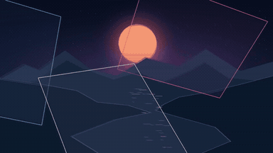
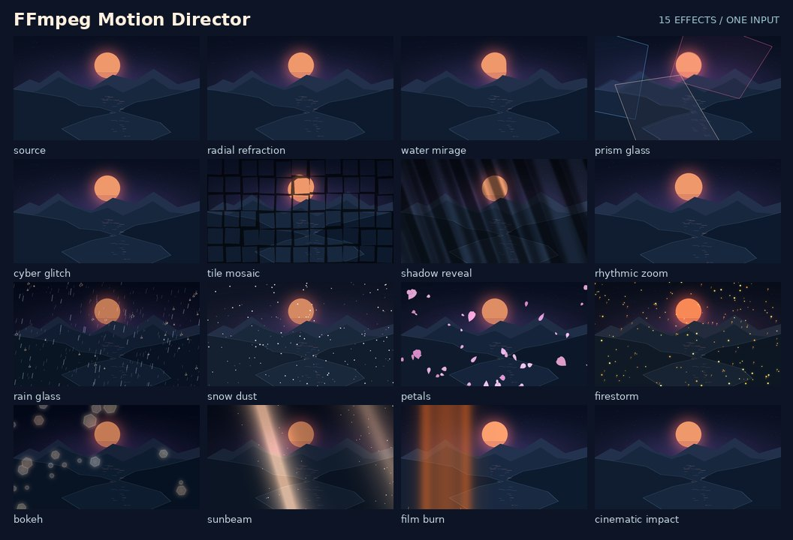

# FFmpeg Motion Director showcase

[FFmpeg Motion Director v0.4.1](../../../skills/ffmpeg-motion-director/) applies 15 procedural effects to still images.



The animation is a compact GIF converted from a six-second H.264 render. The regular batch workflow defaults to thirty-second MP4s.



The grid samples the renderer's actual effect functions at 2.35 seconds on the [same source image](source.jpg). Each tile shows one instant of an animated effect.

## Reproduce the clip

After [setting up the skill dependencies](../../../skills/ffmpeg-motion-director/README.md#setup), run this from the repository root.

```bash
python skills/ffmpeg-motion-director/assets/renderer.py \
  --image docs/showcase/ffmpeg-motion-director/source.jpg \
  --output prism-glass.mp4 --fx prism_glass --duration 6 --fps 16
```

The preview MP4 was checked for 96 frames, six seconds, 854 × 480 dimensions, H.264/yuv420p, and full decode. For contact sheets, motion plans, checkpoint and batch ZIPs, follow the [batch CLI walkthrough](../../../skills/ffmpeg-motion-director/README.md#use-the-cli-directly).

The illustrated source was drawn procedurally for this showcase. The other images on this page derive from that source and the bundled FFmpeg Motion Director renderer.
