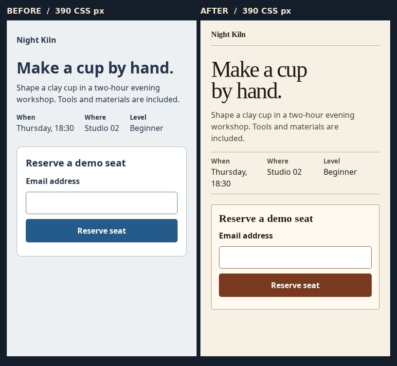

# Hallmark Web Design · Night Kiln

The same pottery workshop and reservation form in two treatments. The redesign puts the workshop title first, groups the decision-critical details, and gives the primary action a distinct color.

[Demo HTML](demo.html) · [Design canon](design.md) · [Browser QA](qa.json)

## What we verified

Both variants were tested in Chromium at 320, 390 and 430 CSS pixels. The tests checked workshop facts, horizontal overflow, keyboard order and visible focus, empty and invalid email handling, and successful submission with a valid email. The form is a local demonstration and sends no email. The browser checks cover this fixture; upstream SlopLint was outside this run.

## Reproduce

Download `demo.html`, open it locally in a browser, then append `?variant=after` to switch to the redesign. In a narrow viewport, tab to the email field and submit with `visitor@example.test`. Expect “Demo seat reserved. No email was sent.” Try an empty or invalid email to check native validation.
