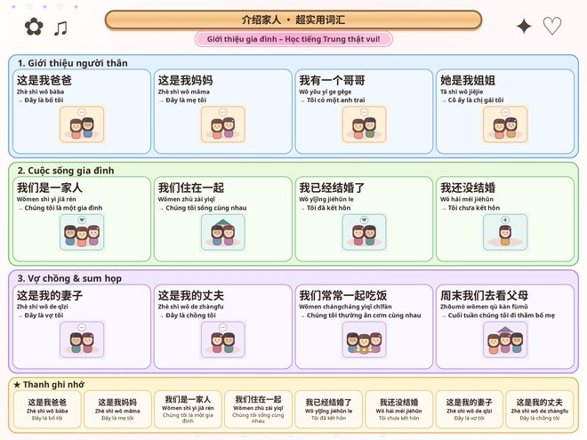

# HanYu Visual Lab · Introducing family

A Mandarin lesson with 12 phrases. The HanYu renderer takes structured text and textless illustrations, then typesets Mandarin, Pinyin and Vietnamese in the poster.

[](poster.png)

| Mandarin | Pinyin | Vietnamese |
| --- | --- | --- |
| 这是我爸爸 | Zhè shì wǒ bàba | Đây là bố tôi |
| 我们是一家人 | Wǒmen shì yì jiā rén | Chúng tôi là một gia đình |
| 我们常常一起吃饭 | Wǒmen chángcháng yìqǐ chīfàn | Chúng tôi thường ăn cơm cùng nhau |

[Full PNG](poster.png) · [Editable HTML](infographic.html) · [Lesson JSON](../../../skills/hanyu-visual-lab/examples/topic-introducing-family.json) · [Browser QA](qa.json)

The renderer reported `PASS_ILLUSTRATED` in Chromium. All 12 cards had illustrations, their rendered text matched the source, and the renderer reported zero layout issues. The run verifies layout and text round-trip fidelity. The phrases come from the bundled example lesson.

## Reproduce

Set up [HanYu's renderer and fonts](../../../skills/hanyu-visual-lab/README.md#requirements), then run from the registry root. The illustration sheet contains original textless drawings made for this example, in lesson ID order.

```bash
python3 skills/hanyu-visual-lab/scripts/slice_art_sheet.py \
  docs/showcase/hanyu-visual-lab/illustration-sheet.png --rows 3 --cols 4 \
  --ids 01,02,03,04,05,06,07,08,09,10,11,12 --out hanyu-demo/assets/illustrations

python3 skills/hanyu-visual-lab/scripts/render.py render \
  skills/hanyu-visual-lab/examples/topic-introducing-family.json \
  --art-root hanyu-demo --out hanyu-demo/render
```
